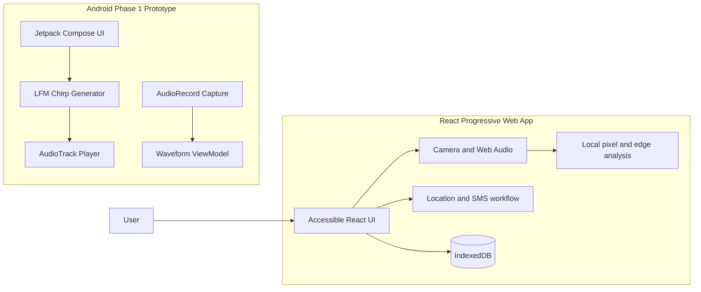

# EchoMap Edge

<div align="center">

**Privacy-first accessibility and emergency assistance for a disconnected world**

[](LICENSE)
[](#web-app)
[](#android-phase-1-prototype)

<br>

[Features](#-key-features) · [Architecture](#-architecture) · [Quick Start](#-quick-start) · [Web App](#web-app) · [Android](#android-phase-1-prototype) · [Privacy](#-privacy-and-safety) · [Roadmap](#-development-status-and-roadmap)

</div>

---

## About the Project

**EchoMap Edge** is an assistive and emergency-support prototype that combines browser-based edge analysis with an Android acoustic research implementation. It is designed around two primary needs:

- **Accessibility:** understand nearby scenes, read visible text, locate structured objects, and receive spoken guidance.
- **Emergency assistance:** maintain an emergency profile, store trusted contacts, share location information, and prepare SOS messages without requiring account sign-in or mandatory cloud processing.

The repository contains:

1. A **React/TypeScript Progressive Web App** focused on an accessible user experience and browser hardware integration.
2. An **Android/Jetpack Compose prototype** for recording and playing low-frequency acoustic chirps.

> EchoMap Edge is an assistive technology and research prototype, not a replacement for a white cane, emergency service, medical advice, or professional mobility support.

---

## ✨ Key Features

### Accessibility Companion

| Capability | Current implementation |
|---|---|
| Scene analysis | Local Canvas-based luminance and Sobel edge analysis |
| Doorway detection | Tall parallel-edge structure detection |
| Furniture detection | Horizontal-seat and furniture-signature analysis |
| Text recognition | Browser-based OCR interface and text-reading workflow |
| Grounded voice questions | On-device query flow with remembered scene/OCR context |
| Audio guidance | Speech synthesis, configurable speech parameters, and haptic feedback |
| Object proximity | Audio beacon and spatial-position guidance |

### Emergency & Disaster Center

- Prominent SOS trigger with accidental-dispatch countdown
- Emergency profile with blood type, allergies, medical conditions, medications, and mobility needs
- Primary and secondary emergency contacts
- GPS, network, manual-description, and unavailable-location states
- Prefilled SMS and share workflows
- Earthquake, flood, fire, severe-weather, and general-survival guides
- IndexedDB storage for contacts, attempts, events, settings, and profiles
- Test/drill mode that clearly identifies simulated dispatch activity

### Acoustic Mapping

- Live Web Audio microphone meter and waveform visualization
- Configurable speaker-to-microphone latency profile
- Web Audio hardware calibration workflow
- Ghost-wall and walking-person filtering logic
- Android Phase 1 chirp playback and PCM recording
- 2–8 kHz linear-frequency modulation with a tapered cosine window

---

## 🏗 Architecture



### Technology Stack

| Area | Technology |
|---|---|
| Web framework | React 19 |
| Language | TypeScript |
| Build tool | Vite 8 |
| Styling | Tailwind CSS 4 |
| Iconography | Lucide React |
| Local storage | IndexedDB |
| Audio | Web Audio API and browser MediaDevices API |
| Android | Kotlin, Jetpack Compose, Material 3 |
| Android audio | `AudioTrack` and `AudioRecord` |
| Minimum Android | API 26 / Android 8.0 |
| Android compile target | API 34 |
| Android build | Gradle 17 / JDK 17 |

---

## 🚀 Quick Start

### Prerequisites

- Node.js 20 or newer
- npm
- A modern browser
- Android Studio if building the native prototype
- JDK 17 if running the Android Gradle build

### Run the Web App

```bash
git clone https://github.com/jyothirmaigowda/EchoMap-Edge.git
cd EchoMap-Edge
npm install
npm run dev
```

Open **http://localhost:3000**.

### Verify the Web Build

```bash
npm run build
npm run lint
```

### Serve the Production Build

```bash
npm run preview
```

### Optional Environment Configuration

Copy `.env.example` to a local environment file only when a deployment or integration actually requires the values.

```text
.env.local
.env.production.local
```

Do not commit API keys, credentials, tokens, contacts, or personal emergency information.

---

## <a id="web-app"></a>Web App

The web application is configured to run on port `3000` and expose Vite to the local network.

### Browser Permissions

Some features require user consent:

| Feature | Permission |
|---|---|
| Camera analysis | Camera |
| Microphone telemetry | Microphone |
| Location-aware SOS | Geolocation |
| Haptic feedback | Device support |
| SMS/composer launch | Messaging app handling |
| Speech output | Browser Speech Synthesis |

Use HTTPS or `localhost` for secure browser APIs. Camera, microphone, geolocation, service-worker, and installation behavior may vary by browser and device.

### Progressive Web App

The repository includes a web manifest, icons, and service worker configuration for installable/PWA-oriented deployment. Offline behavior depends on the deployed origin, browser support, cached assets, and locally stored data.

### Mobile Access

From the running machine, use the QR/mobile connection screen to reach the app on a compatible phone. Mobile hardware features require:

- A trusted HTTPS origin or localhost pairing method
- Browser permission grants
- A device with supported camera/audio APIs
- Messaging app support for `sms:` or sharing actions

> Web apps cannot guarantee silent or carrier-delivered SMS dispatch. The app prepares a message and intentionally records whether the user reached the messaging application; it should not claim confirmed carrier delivery unless the platform provides an actual delivery report.

---

## <a id="android-phase-1-prototype"></a>Android Phase 1 Prototype

The Android module verifies whether a smartphone can generate, play, and record an acoustic chirp for research purposes.

### Current Phase

Phase 1 validates:

- 16-bit PCM mono chirp synthesis
- 48 kHz default configuration
- 2–8 kHz linear FM chirp
- 60 ms chirp duration
- Tukey 10% onset/offset taper
- `AudioTrack` playback
- `AudioRecord` capture
- Recording synchronization with a 30 ms pre-roll and 210 ms listening window
- Live waveform, peak amplitude, RMS amplitude, and clipping indicators
- Lifecycle-safe recording state management

### Phase 1 Limitations

- No proven wall, doorway, or obstacle detection claim
- No correlated echo peaks
- No validated time-of-flight measurement
- No room reconstruction claim
- Real-world latency, echo cancellation, speaker response, and microphone behavior vary by hardware
- The web sonar presentation may use modeled echoes, not measurements

### Android Structure

```text
app/src/main/java/com/echomap/edge/
├── MainActivity.kt
├── audio/
│   ├── AudioPlayer.kt
│   ├── AudioRecorder.kt
│   ├── AudioScanController.kt
│   └── ChirpGenerator.kt
├── ui/
│   └── LiveScanScreen.kt
└── viewmodel/
    └── AudioScanViewModel.kt
```

### Build and Test

```bash
./gradlew assembleDebug
./gradlew test
./gradlew connectedAndroidTest
```

Install the debug APK:

```bash
adb install -r app/build/outputs/apk/debug/app-debug.apk
```

### Hardware Protocol

Use the provided research log when conducting real-device tests:

- [Research protocol](research/phase1_results.md)

Record the device model, audio source, OS version, actual sample rate, peak/RMS values, speaker placement, microphone placement, and observed speaker-to-mic crosstalk. Do not interpret a displayed waveform as measured distance or a confirmed wall.

---

## 📁 Repository Layout

```text
.
├── public/                 # PWA manifest, icons, service worker
├── src/
│   ├── components/         # React feature and layout components
│   ├── data/               # Offline guides and native source assets
│   ├── services/           # DB, location, SMS, vision, speech, and sonar
│   ├── types/              # Shared application types
│   ├── App.tsx             # Main app routing and application state
│   └── main.tsx            # React entry point
├── app/                    # Android Jetpack Compose prototype
├── research/               # Hardware test protocol and results log
├── package.json
├── vite.config.ts
└── README.md
```

---

## 🔒 Privacy and Safety

EchoMap Edge is designed with local-first principles:

- Emergency profiles and contacts are stored in browser IndexedDB
- The current web analysis does not require an account for local interaction
- Camera/audio/location data is handled at the device permission layer
- SOS status transitions are designed to avoid false claims about delivery
- Web test mode is separated from real dispatch language
- No telemetry or analytics dependency is part of the core Android prototype

Before deployment, review applicable permissions and privacy requirements, especially for:

- Medical and emergency data
- Precise location
- Camera and microphone feeds
- SMS/share integrations
- Browser data retention
- Service-worker caches
- Third-party hosting and analytics

---

## 🧪 Development Status and Roadmap

| Area | Status |
|---|---|
| Accessible React interface | Implemented prototype |
| Local IndexedDB records | Implemented |
| Browser scene analysis | Implemented using luminance/Sobel heuristics |
| OCR workflow | Implemented as a browser feature surface |
| Voice query grounding | Prototype workflow |
| SOS confirmation and location workflow | Implemented prototype |
| Actual carrier SMS delivery | Not guaranteed by web platform; messaging app/user action required |
| Acoustic chirp generation and recording | Android Phase 1 implemented |
| Echo cross-correlation | Not yet empirically implemented |
| Wall/time-of-flight mapping | Research phase; not production validated |
| Android camera accessibility integration | Future integration |
| Hardware-field evidence | Research log template requires real-device results |

### Planned Phase 2

- Cross-correlation and matched-filter echo detection
- Pulse/echo timing calibration
- Physical wall and opening validation
- Empirical accuracy benchmarks
- Noise and multipath robustness testing
- Device-specific calibration profiles
- Camera/sonar sensor fusion
- Repeatable Android instrumentation tests
- Accessibility and emergency workflow hardening

---

## 🩺 Safety Notice

EchoMap Edge is not an emergency dispatch service.

Always verify real location and recipient information before sending a distress message. In a real emergency:

- Contact the local emergency number when available
- Follow local emergency instructions
- Keep a physical white cane or other mobility aid and safe mobility practices
- Do not rely on a prototype to detect obstacles or navigate alone
- Do not test real SOS messaging against emergency services without authorization

---

## 🤝 Contributing

Contributions are welcome for:

- Accessibility and screen-reader usability
- OCR and camera processing
- SOS safety and verification
- Offline guide content
- Android audio engineering
- Real-device acoustic testing
- Privacy-preserving analytics alternatives
- Documentation and localization

For code contributions:

1. Fork the repository.
2. Create a feature branch.
3. Keep changes focused and testable.
4. Run the relevant web or Android checks.
5. Open a pull request with tests, screenshots, and known limitations.

---

## 📄 License

Licensed under the [Apache License 2.0](LICENSE).
